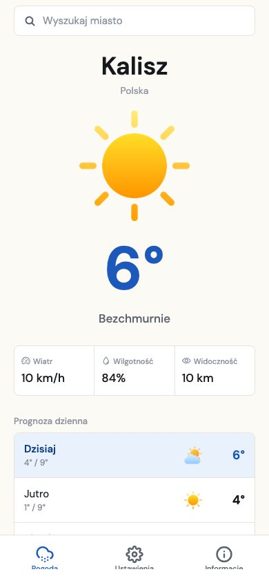
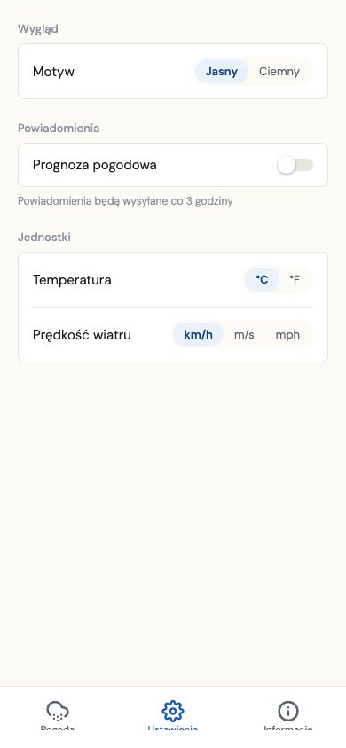
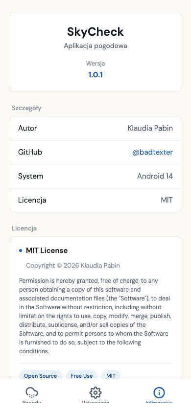

# SkyCheck

A weather app for iOS, Android and web, built with React Native and Expo. Search any city, see the current conditions plus a 3-day and hourly forecast, and get a recurring local notification with the latest reading.

<p align="center">
  
  
  
</p>

## Features

- **Current conditions and forecast** — temperature, condition, wind, humidity and visibility, plus a 3-day and hourly outlook for the selected day.
- **City search** — debounced autocomplete against the WeatherAPI locations endpoint.
- **Local notifications** — an optional recurring reminder (every 3 hours) with the current temperature and condition, built on `expo-notifications` with a web-safe no-op fallback.
- **Units and theme** — switch between °C/°F and km/h, m/s, mph; light and dark theme. Both persist across launches via `AsyncStorage`.
- **Distinct loading, error and success states** — a failed request (bad city, no connection) surfaces a retry action instead of silently showing stale or empty data.
- **A deliberate visual identity**, not a default one — see [Design](#design) below.

## Design

The first pass looked like every other weather app: a blue sky-gradient background and iOS-style glass cards — the default a model (or a quick tutorial) reaches for. The brief was to make it look designed, not generated.

The interface went through a few real directions — a true-black flat style, a dense "data-terminal" mono-numeral layout — before settling on the current one: flat surfaces, one accent colour reserved for data and selection (never decoration), and a custom palette carried consistently across both themes. Settings uses segmented pickers with a filled active state instead of an iOS-style grouped list with chevrons, so it doesn't read as a platform default either.

Typeface: [DM Sans](https://fonts.google.com/specimen/DM+Sans).

## Tech stack

- **[Expo](https://expo.dev) / React Native**, routed with `expo-router` (file-based routing, typed).
- **TypeScript**, strict enough to type the WeatherAPI response shape rather than reach for `any`.
- **[WeatherAPI.com](https://www.weatherapi.com/)** for current conditions, forecast and location search.
- **`AsyncStorage`** for the selected location, theme and unit preferences.
- **`expo-notifications`**, with a platform-specific implementation (`.native.ts` vs `.ts`) so the web build doesn't pull in native-only APIs.
- **Jest + React Native Testing Library** for unit and component tests.

## Project structure

```
app/
  _layout.tsx     tab navigation, theme and font loading
  index.tsx       weather screen: search, current conditions, forecasts
  settings.tsx    theme and unit pickers
  info.tsx        app info and license
  __tests__/
api/
  weather.js      WeatherAPI client
  secret.js       API key (gitignored — see Setup)
services/
  theme.tsx       light/dark theme tokens and context
  units.tsx       °C/°F and km/h/m/s/mph formatting and persistence
  weatherNotifications(.native).ts   recurring local notification
  __tests__/
docs/screenshots/
```

## Setup

```bash
git clone https://github.com/badtexter/weather-app.git
cd weather-app
npm install
```

The app needs a free [WeatherAPI.com](https://www.weatherapi.com/) key. Create `api/secret.js` (it's gitignored, so your key never gets committed):

```js
export const API_KEY = "your_weatherapi_key";
```

Then run it:

```bash
npx expo start      # press i / a / w for iOS, Android or web
npm run web          # web directly
npm run android       # Android directly
npm run ios           # iOS directly
```

## Testing

```bash
npm test             # run once
npm run test:watch   # watch mode
```

Covers the formatting and unit-conversion logic, the condition-translation and icon-mapping helpers, and a render smoke test for the Info screen.

## Known limitations

- One saved location at a time — no list of favourites.
- The API key ships in the client bundle, as any Expo app without a backend proxy does; fine for a personal/portfolio project, not for a production app handling a paid API tier.
- No end-to-end tests of the live network calls (the test suite covers logic and rendering, not the WeatherAPI integration itself).

## License

MIT — see the in-app [Info screen](app/info.tsx) or the license text there.

## Weather icon credits

- Cloudy icons created by berkahicon — https://www.flaticon.com/free-icons/cloudy
- Rainy icons created by berkahicon — https://www.flaticon.com/free-icons/rainy
- Rain icons created by apien — https://www.flaticon.com/free-icons/rain
- Cloudy icons created by Design View — https://www.flaticon.com/free-icons/cloudy
- Sunny icons created by Md Tanvirul Haque — https://www.flaticon.com/free-icons/sunny
- Thunderstorm icons created by berkahicon — https://www.flaticon.com/free-icons/thunderstorm
- Snow icons created by berkahicon — https://www.flaticon.com/free-icons/snow
- Foggy icons created by apien — https://www.flaticon.com/free-icons/foggy
- Wind icons created by Icon Mart — https://www.flaticon.com/free-icons/wind
- Humidity icons created by Christ Design — https://www.flaticon.com/free-icons/humidity
- Sunrise icons created by Icon Hubs — https://www.flaticon.com/free-icons/sunrise
- Sunset icons created by Icon Hubs — https://www.flaticon.com/free-icons/sunset
- Pollen icons created by Defamiravi Studio — https://www.flaticon.com/free-icons/botanic

